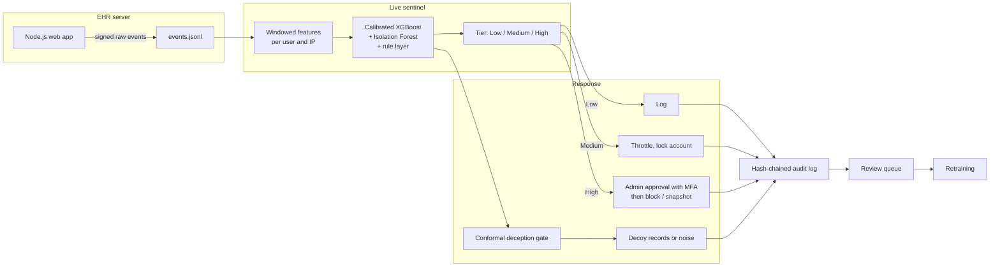

# SentiHealth

**Intrusion detection and response for hospital information systems, with a provable bound on how often legitimate staff are served decoy data.**

[](https://github.com/Riya-337/SentiHealth/actions/workflows/ci.yml)


SentiHealth watches activity on a hospital EHR (electronic health record) server, scores every user and IP with calibrated machine-learning models, and responds in proportion to the risk: logging, throttling, account locks, or blocking after an administrator approves with MFA. Every action goes into a tamper-evident audit log.

Its research contribution is **safety-bounded deception**. Serving fake patient records to an attacker is a strong defence, but serving them to a clinician by mistake can harm a patient. SentiHealth decides when to deceive with a per-role conformal gate that guarantees, for every staff role, that a legitimate session is deceived with probability at most α (for example 1 %), as long as each role's behaviour stays comparable to its calibration period. The experiments test that condition, including where it fails.

> Built by [Riya Aggarwal](https://github.com/Riya-337), RV College of Engineering, Bengaluru · Unisys Innovation Program 2026: Top 50 nationally.

---

## Contents

1. [Research: safety-bounded deception](#research-safety-bounded-deception)
2. [How it works](#how-it-works)
3. [Detection models](#detection-models)
4. [Quickstart](#quickstart)
5. [Reproducing the experiments](#reproducing-the-experiments)
6. [Repository layout](#repository-layout)
7. [Limitations](#limitations)

---

## Research: safety-bounded deception

**Method.** A session is one user's or IP's activity without a gap longer than 30 minutes. The session is deceived from the first moment its running maximum risk score exceeds a threshold τ. τ is set by split conformal prediction on the whole-session maxima of known-legitimate sessions, separately for each staff role (Mondrian calibration). If future legitimate sessions resemble the calibration sessions, then for every role

```
P(a legitimate session is ever deceived) ≤ α
```

The bound covers the whole session, so the repeated per-event decisions do not add up. Mislabelled attacks in the calibration set can loosen it, but by at most a factor of 1 + m/(n+1) for m mislabelled among n sessions. Statements and proofs: [`docs/theory.md`](docs/theory.md). Research write-up: [`docs/research_safe_deception.md`](docs/research_safe_deception.md). Positioning against prior work: [`docs/related_work.md`](docs/related_work.md). Code: [`ml/safe_deception.py`](ml/safe_deception.py).

**Results on a public benchmark.** CERT Insider Threat r4.2: 4.13 M logon, USB, file and e-mail events grouped into 1.44 M sessions, the gate re-deciding at every event. Time-ordered calibration (earlier sessions calibrate, later ones evaluate), α = 1 %, mean of 5 seeds; "significant" counts role-seeds whose rate is significantly above α:

| Detector | Per-role gate: worst role | Significant | Shared threshold: worst role | Significant | Malicious sessions deceived |
|---|---|---|---|---|---|
| Isolation Forest | 1.48 % | 0 / 195 | 13.42 % | 52 / 195 | 3.4 % |
| XGBoost | 6.68 % | 61 / 195 | 8.48 % | 34 / 195 | 66.3 % |

The overall rate matches α in every setting. A shared threshold lets some roles carry many times their share of false deceptions; the per-role gate prevents this with the anomaly detector. With the supervised detector it does not: in roles with only two or three members, one person whose behaviour changes between the calibration and evaluation periods pushes the whole role above α (for example 5 of 355 sessions deceived before, 62 of 381 after). Monthly recalibration does not fix this, because it is individual rather than population drift. The detector that keeps every role safe is also the one that catches few insiders. Details: [`evaluation/CERT_SESSIONS.md`](evaluation/CERT_SESSIONS.md), the one-decision-per-day version [`evaluation/CERT_R42.md`](evaluation/CERT_R42.md), and the analysis in [`docs/research_safe_deception.md`](docs/research_safe_deception.md#33-cert-insider-threat-r42-public-benchmark).

**Other findings.**
- On **WUSTL-EHMS-2020** (a public healthcare network testbed), XGBoost reaches F1 1.00 only because of identifier columns (addresses, ports, MACs). Without them F1 is 0.71. [`evaluation/WUSTL_EHMS.md`](evaluation/WUSTL_EHMS.md)
- Calibrating on single events instead of whole sessions fails: on the simulator it deceives 61 % of legitimate sessions at α = 1 %, against 1.2 % for the session-level gate. Under behaviour drift the bound can be exceeded (2.9 % at α = 1 %), and recalibrating on the last 7 days restores it. [`evaluation/DECEPTION.md`](evaluation/DECEPTION.md)
- An attacker who knows the thresholds must slow loud attacks (brute force, DDoS, fast exfiltration) to near-normal behaviour to avoid deception, while already-slow attacks evade cheaply. Per-role thresholds can be exploited by an attacker who controls an account of the most permissive role. [`evaluation/ADAPTIVE.md`](evaluation/ADAPTIVE.md)

---

## How it works



| Component | Where |
|---|---|
| EHR web app (the system being protected) | `webapp/` |
| Live sentinel: tails events, builds features, scores | `core/live_sentinel.py`, `ml/features.py`, `ml/scoring_matrix.py` |
| Tiered response with dry-run mode and rollback | `core/self_healing_responder.py`, `core/response_adapters.py` |
| Deception: decoy records, noise, conformal gate | `deception/`, `ml/safe_deception.py` |
| Dashboard backend (Flask) and frontend (React, TypeScript) | `api/dashboard.py`, `frontend/` |
| Security: MFA for every user, sessions, signed events, audit-chain anchoring | `security/`, `api/dashboard.py` |
| Privacy: pseudonymised display, crypto-shredding | `privacy/` |

Security notes: every user enrols in TOTP MFA; sessions are stored hashed with an idle timeout; automatic account lockouts expire after 15 minutes; response actions run in dry-run mode by default (`SENTIHEALTH_DRY_RUN=1`). Configuration is through the environment variables listed in [`.env.example`](.env.example).

---

## Detection models

No public dataset of hospital EHR access logs with labelled attacks exists, so `ml/simulate_events.py` generates minute-level activity for 120 users over 14 days, with ten attack families including stealthy ones (low-and-slow brute force, slow exfiltration, off-hours insider access). One family, `credential_stuffing`, is held out of training. Models are trained with a temporal split (70 % train, 15 % validation and calibration, 15 % test) on 29 windowed features per user and IP.

Test period (50,130 rows, 562 attacks), **synthetic data**:

| System | Macro F1 | High-tier recall | High-tier precision |
|---|---|---|---|
| XGBoost, calibrated (deployed) | 0.974 | 0.997 | 0.981 |
| Random Forest, calibrated | 0.972 | 1.000 | 0.981 |
| Earlier five-model ensemble | 0.958 | 0.994 | 0.983 |
| Expert rules only | 0.556 | 0.997 | 0.616 |

These numbers show the pipeline works on data written by the same author as the features; they are not evidence of performance in a real hospital. Full report: [`evaluation/REPORT.md`](evaluation/REPORT.md).

---

## Quickstart

### With Docker

```bash
docker compose up --build
```

Dashboard backend on `http://localhost:5001`, frontend on `http://localhost:4173`, EHR web app on `http://localhost:3000`.

### Locally

Python 3.12+ and Node.js 18+.

```bash
bash scripts/setup.sh && source .venv/bin/activate
python3 ml/simulate_events.py && python3 ml/train.py   # about 2 minutes
python3 api/dashboard.py                               # backend on :5001
```

In other terminals:

```bash
cd webapp && node app.js                    # EHR web app on :3000
python3 core/live_sentinel.py               # scores events as they arrive
cd frontend && npm install && npm run dev   # dashboard UI
```

On first start the dashboard opens a **setup page** that makes you choose an admin password and enrol MFA. Then run an attack simulation, for example `python3 attack_scripts/exfiltration.py`, and watch it being detected on the dashboard.

### Tests

```bash
python3 -m pytest -q
```

GitHub Actions trains the models and runs the full suite on every push.

---

## Reproducing the experiments

| Experiment | Command | Output |
|---|---|---|
| Detection models (synthetic) | `python3 ml/simulate_events.py && python3 ml/train.py && python3 ml/evaluate.py` | `evaluation/REPORT.md` |
| Deception gate (synthetic) | `python3 ml/experiments/deception_guarantee.py --seeds 5` | `evaluation/DECEPTION.md` |
| WUSTL-EHMS-2020 | `bash scripts/fetch_datasets.sh wustl && python3 ml/datasets/wustl_ehms.py` | `evaluation/WUSTL_EHMS.md` |
| CERT r4.2 | `bash scripts/fetch_datasets.sh cert && python3 ml/datasets/cert_r42.py all` | `evaluation/CERT_R42.md` |
| CERT r4.2 feature ablation | `python3 ml/datasets/cert_r42.py experiment --ablation scenario_web` | `evaluation/CERT_R42_NO_SCENARIO_WEB.md` |
| CERT r4.2 event-level sessions | `python3 ml/datasets/cert_sessions.py` (after `cert_r42.py all`) | `evaluation/CERT_SESSIONS.md` |
| Adaptive attacker (synthetic) | `python3 ml/experiments/adaptive_attacker.py` | `evaluation/ADAPTIVE.md` |

Public datasets are not redistributed; the fetch script downloads them from their original sources. CERT r4.2 is a 4.8 GB download; the archive can be deleted after extraction.

---

## Repository layout

```
SentiHealth/
├── api/            Flask dashboard backend
├── frontend/       React + TypeScript dashboard
├── webapp/         Node.js EHR server (the system being protected)
├── core/           live sentinel, response engine, incidents, review queue
├── ml/             features, training, scoring, conformal deception gate
│   ├── datasets/       public-benchmark loaders (CERT r4.2, WUSTL-EHMS-2020)
│   └── experiments/    deception-guarantee experiment
├── deception/      decoy records and noise (Mirage)
├── security/       sessions, signed events, audit-chain anchoring, secrets
├── privacy/        pseudonymisation, crypto-shredding
├── notifications/  console, SMTP and Telegram alerting
├── evaluation/     measured results (Markdown reports and raw JSON)
├── attack_scripts/ attack simulations for end-to-end testing
├── demos/          standalone demonstrations
├── scripts/        setup, dataset download, backups, recovery, monitoring
├── tests/          pytest suite
├── config/         thresholds, policies, roster (secrets are created at first run)
├── models/         model manifest and decision policy (trained models are not committed)
├── deploy/         Dockerfiles
└── docs/           research note, theory (proofs), related work; archive/ holds the first version's design documents
```

---

## Limitations

- **Synthetic EHR data.** The detection models are trained and evaluated on simulated hospital activity. The deception gate is also evaluated on two public datasets, but CERT r4.2 is itself synthetic.
- **The guarantee needs exchangeability.** It assumes future legitimate sessions resemble the calibration sessions. Under drift it can be exceeded until the gate is recalibrated.
- **Single-node audit log.** Hash chaining and anchoring make tampering detectable, not impossible, for an attacker with root on the host.
- **Mock EHR.** The protected system is a small Node.js app, not a production EHR (for example via HL7 FHIR).

## License

MIT, see [`LICENSE`](LICENSE).
